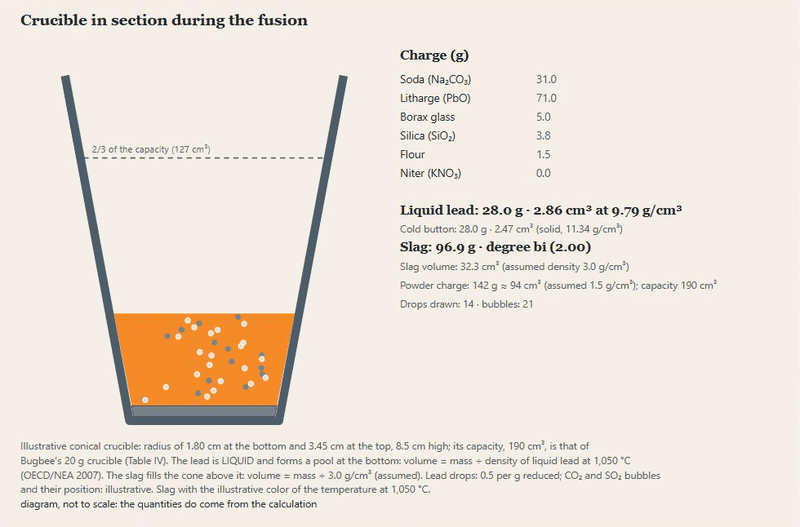

[Versión en español](README.md)

# laboratorio-ensayos (fire-assay laboratory)

A fire-assay laboratory. **Phase 1: sample preparation** and **phase 2: flux charge**. It calculates how much sampling error each stage of a preparation protocol adds (crushing, splitting, pulverizing, taking the 30 or 50 g aliquot) with Gy's fundamental sampling error equation, how much accumulates, and how many gold grains fall in the aliquot when the gold is coarse. Implemented from the literature and validated against published numbers.

No cupellation or gold and silver losses, no slag thermodynamics and no platinoid assay. The PREP-31 and PREP-31B preparation codes are public ALS codes (alsglobal.com); no affiliation.



**[▶ Try it in the browser](https://laboratorio-ensayos-bromrnpno3wqjwkdmqcuov.streamlit.app/?lang=en)** (Streamlit Community Cloud, no sign-up). The app has an Español / English selector at the top of the sidebar; `?lang=en` opens it in English.

## What it does

- **Protocol:** Gy variance per stage and cumulative (sum of relative variances), with a sampling nomogram in which the protocol route is walked stage by stage (reducing the size is a horizontal leg; splitting, a vertical one). Presets PREP-31, PREP-31B and the protocol of a gold mine from Minnitt (2017).
- **Coarse gold:** expected grains in the aliquot, simulation of 1,000 repeated assays (Poisson, fixed seed), screen fire assay recommendation if fewer than 20 grains are expected (Clifton's criterion).
- **Fusion (phase 2):** given the mineralogy of the sample (9 minerals) and the aliquot (1 assay-ton or 30 g), it calculates the flux charge (litharge, sodium carbonate, borax, silica, flour or niter) that gives a lead button of 25 to 30 g and a slag of the chosen silicate degree (mono, sesqui or bi); it evaluates a changed charge (small or large button, acid or basic slag, risk of matte) and draws the conical crucible in cross-section, with the liquid lead at the bottom and the slag on top.
- **Bottle roll:** recovery and head grade by balance from (time, gold in solution, gold in residue), unreacted-core terms L, M and N with their lines, a power-law model and a first order with plateau, and a bottle in section turning at 30-32 rpm with a recovery gauge (see below).
- **Validation:** table and charts of what is calculated against what is published.
- **Guide:** the fundamental error, the factors and what datum each one asks for, and which sampling errors are NOT modeled.

## The equation

```
σ² = c·f·g·ℓ·dN³·(1/MS − 1/ML) = K·dN^α·(1/MS − 1/ML)      (dN in cm, masses in g)
```

The two forms are the same: K and α **are calibrated per mineral** (heterogeneity test or sampling tree) and are never assumed. Those of the example (DSA: K = 167.4, α = 1.123; SFA: K = 2,539, α = 1.03) are the ones Minnitt (2017) calibrated for a Witwatersrand gold ore and do not apply to another mineral. The size dN of each stage comes from its specification ("70 % under 2 mm") plus a Rosin-Rammler shape with an **assumed** slope m (the app shows how much the error changes with m, because dN is cubed). The lot-mass correction (1/MS − 1/ML) can be switched off to reproduce Minnitt's (2017) Table VIII, which omits it.

## How to run it

```bash
pip install -e ".[dev,app]"
streamlit run app/streamlit_app.py
pytest --cov=muestreo
```

For the cloud, `requirements.txt` is enough (pinned versions; `conminucion` pinned to a commit). The size distribution uses `conminucion.sizes` from [simulador-conminucion](https://github.com/Laxionx/simulador-conminucion).

## Validation

Thresholds were fixed before running ([tests/test_validacion.py](tests/test_validacion.py)). What does not match is shown as it is, with no `xfail` or touch-ups.

| Source | Published | Calculated | Matches? |
|---|---|---|---|
| Minnitt (2017), *J. SAIMM* 117(2), Table VIII | 19 variances per stage (DSA and SFA) | σ² = K·dN^α/MS, no lot correction | **18 of 19** at the published rounding. One SFA row does not match (2,055.56 g, dN 0.0001 cm): it publishes 0.00005 and gives 0.000094; the next row does match |
| Chieregati (2017), *Mining Engineering*, Table 2 | 3 stages and total (0.1079; 32.8 %) | IHL = 3.9787·d^1.6689 with lot correction | **14 of 14** at the published rounding |
| Clifton et al. (1969), USGS PP 625-C, Fig. 4 | ±34/54 % (20), ±20/25 % (75), ±9/10 % (400), −50/+100 % (7) | equations (11) and (12) of the paper | **7 of 8** within ±2 points; the lower limit for 7 particles comes out −46.6 % (3.4 points: the figure's label is round). Exact Poisson gives −59.8 % |
| Minnitt, Rice and Spangenberg (2007), *J. SAIMM* 107(8) | 29.58 %, ≈16 kg and 0.9 cm | with the printed data: 11.69 %, 2.50 kg and 1.69 cm | **does not match: a finding, not a validation** (see below) |

**Minnitt (2007).** The paper prints ℓ = 0.000035, but its results imply a value 6.4 times larger (c·f·g·ℓ = 448 instead of 70, effective ℓ 0.000224); here the formula is used with the printed data. With 448 the three problems are reproduced (29.58 %, 16,015 g, 0.91 cm) and the appendix one (32.49 %), and what does match in the appendix is the liberation size dℓ = 1.25·(3.5e-5)^(1/1.5) = 0.001337 cm. It is an erratum in the paper, not a validation of the formula.

The coarse-gold simulation is validated against Poisson: mean and standard deviation of the 1,000 assays within 3σ of the analytical value (Monte Carlo error), with a fixed seed.

## Phase 2: flux charge

The module `muestreo.fusion` (with `fusion_avisos`, `quimica` and the validation data in `fusion_datos`) calculates:

- the **reducing power** of the sample by stoichiometry (g of Pb that 1 g of the mineral reduces with litharge in excess; the sulfur leaves as SO2 or as SO3, as in Bugbee) and that of the flour (**laboratory datum**: Bugbee gives 10 to 12, the USGS 10 to 11; initial value 11);
- the **niter** if the sample reduces too much (oxidizing power, laboratory datum: 4.0 to 4.2 according to Bugbee; 5.12 the theoretical);
- the acid-base balance for the requested **silicate degree** (acid oxygen / base oxygen: mono 1, sesqui 1.5, bi 2) with silica and borax (1 g of borax glass is equivalent to 0.6 g of silica);
- the expected **button**, the composition and degree of the slag and the **warnings**: button outside 25 to 30 g, slag more acid than trisilicate or more basic than monosilicate, risk of matte with sulfides, too little litharge (Lodge's excess) or too much copper (Perkins, USGS). Each threshold carries its citation; those without a published citation are labeled "assumed threshold".

Sources, both public domain: Bugbee (1922), *A Textbook of Fire Assaying*, and Haffty, Riley and Goss (1977), *A Manual on Fire Assaying*, USGS Bulletin 1445. It is not any laboratory's recipe. Fusion temperature for the crucible color: 1,050 °C (USGS). The crucible is a **cone** (wide at the top) of 190 cm³ capacity, that of Bugbee's 20 g muffle crucible (Table IV; its radii and height, 1.8, 3.45 and 8.5 cm, are **illustrative**). During the fusion the lead is **liquid**, a pool at the bottom of the cone with volume = mass ÷ density of liquid lead at 1,050 °C (11,367 − 1.1944·T kg/m³, T in K: 9.787 g/cm³; OECD/NEA 2007, ch. 2, eq. 2.23; the correlation of Assael et al. could not be verified in an open copy, and at 600.6 K this line gives 10.650 against the 10.656 that Assael gives). The slag fills the cone above it (its density, 3.0 g/cm³, is an **illustrative assumption**, because Bugbee does not give it); the level of each layer comes from integrating the cone, so the lead always stays below the slag. The cold button (g and cm³ with 11.34 g/cm³, CRC) is given separately. Warnings: the powder charge (with 1.5 g/cm³, assumed) or the melt exceeding 2/3 of the capacity (Bugbee: "never more than two-thirds full") or the whole capacity.

### Phase 2 validation

Thresholds were fixed before running ([tests/test_fusion.py](tests/test_fusion.py)); the app ALWAYS calculates with current atomic weights; Bugbee calculated by hand with rounded weights and sometimes truncated. Each figure is shown with four columns (published, current weights, Bugbee's weights, verdict): "matches", "matches with Bugbee's weights", "Bugbee's truncation" or "does not match" (with its difference, no touch-ups). Bugbee's weight set is in `muestreo/fusion_pesos.py` and is INFERRED from his own figures, in his favor.

| Source | Published | Calculated | Matches? |
|---|---|---|---|
| Bugbee 1922, reducing powers (carbon, iron, sulfur, pyrite), niter, red lead, MnO2 | 34.5; 3.70; 12.9; 19.4; 8.6; 12.9; 12.07; 5.12; 0.30; 2.4 | stoichiometry | of 67 figures: 43 match, 14 match with Bugbee's weights, 3 are his truncation and 7 do not match (see the Validation tab) |
| Bugbee 1922, Table XX (8 minerals, S to SO2 and SO3) | 16 figures | electrons each mineral gives | 10 match; 4 with Bugbee's weights (chalcopyrite SO3, sphalerite SO2, pyrite SO3, pyrrhotite SO2); 2 do not match (arsenopyrite and stibnite, S to SO3) |
| Bugbee 1922, neutralization of bases and Tables XXI and XXII | 0.84 and 0.60 g of SiO2; 1.4 and 1.0 g of borax; 8 + 7 factor figures | stoichiometry | those of 0.84, 0.60, 1.4, 1.0, PbO and MgCO3 do; several of the tables, with his weights or through his truncation; Fe2O3, FeO of Table XXII and CaCO3 do not (his 17.4 does not agree with his own 0.60 g per g, which gives 17.5) |
| Bugbee 1922, example of 50 % CaCO3 and 50 % SiO2 | 8.7; 17.0; 8.1; 33.8; 14.6; 19.2; 12.8; 6.4; 10.7 | with Bugbee's tabulated factors | **9 of 9** exact |
| Bugbee 1922, examples with the calculator | 30.7 and 43.2 g (1 A.T. of pure silica); 10.7, 12.8 and 60 g (50 % CaCO3); 23.6, 28.3 and 60 g (pure CaCO3) | 30.87 and 43.34; 10.70, 12.84 and 60.16; 23.66, 28.39 and 60.16 | within 0.2 g (current stoichiometry) |
| Bugbee 1922, mixture 3.5 : 0.5 : 6 | 100 g ⇒ ≈ bisilicate; 125 g ⇒ ≈ sesquisilicate | degree 2.31 and 1.78 | yes (threshold: 2 ± 0.35 and 1.5 ± 0.35) |
| USGS 1445, niter for a 30 g button | 10.7 g | 10.7 g | yes |

Shown alongside the theoretical ones, without being a threshold: Bugbee's **measured** reducing powers (Table XX) and the USGS charges evaluated with the calculator (button and silicate degree they would give).

## Bottle-roll cyanidation

The "Bottle roll" tab reads a cyanidation test (gold in solution and in the residue against time) and shows which kinetic model truly describes the dissolution and which only looks good in the fit. The `muestreo.cianuracion` module (with `cianuracion_datos`) computes the recovery R = (1 − residue/S0) and the head grade by balance (with a warning when rows are not coherent), the L (diffusion), M (reaction) and N (mixed) terms of the unreacted-core model with their regressions by stretch, the authors' power-law model and a first order with plateau (our own model). A bottle in section turns at the procedure speed (30 to 32 rpm, Cetin et al., 2017) with a recovery gauge that follows the chosen model in compressed time (48 h in 12 s, declared in the drawing).

**Result.** The unreacted-core lines do not go through the origin: their first-stretch intercepts are 0.335 (diffusion), 0.389 (reaction) and 0.385 (mixed), with R² from 0.995 to 0.996 but only 3 points. With them the models would already give 77 % dissolved gold at t = 0, and the measurement gives 79 % at 1 h: they do not explain the fast dissolution of the first hour. The power-law model fits better (R² 0.937; mean error 1.6 recovery points) but is empirical, and the first order with plateau fits poorly (R∞ = 89.2 %, k = 2.13 1/h, R² 0.48).

### Cyanidation validation

Data and figures of Roostaei, Kordparijaei and Mesroghli (2026), *Discover Applied Sciences*, doi 10.1007/s42452-026-08420-8 (open access CC BY-NC-ND; only its quoted figures are used). Cuts fixed before running ([tests/test_cianuracion.py](tests/test_cianuracion.py)):

| Source | What is compared | Match |
|---|---|---|
| Table 4 | Head grade of each row (S0 = residue/(1 − R), must fall in the rounding interval with S0 = 1,070 ppb) and recovery at the rounding | 14 of 14 |
| Table 6 | L and M to 3 decimals; N with the inferred B | 22 of 22 |
| Table 7 | R², intercept and slope of the 6 regressions, with the same points (without the 2 h one) | 15 of 18 |
| Eq. 3 | 228.046; 0.332; R² 0.937 (ln St against ln t, 7 points) | 3 of 3 |

**What does not match.** Row M1 of Table 7 does not come out of the data: with the M terms of Table 6 it gives R² 0.9957, intercept 0.389 and slope 0.018, and the paper prints 0.994, 0.388 and 0.019; its printed F (171.04) implies R² 0.9942, which agrees with its own R² but not with the data, and the other five rows do match. It looks like a typo and was not dressed up. Also, the Table 4 data come from tests in a stirred 2 L beaker, not a bottle: the bottle illustrates the test.

**What was inferred** (the paper does not publish it and it is declared): the constant B of the mixed term, 0.7033 up to 7 h and 0.75 from 7 to 48 h (ranges compatible with the rounding: 0.7028 to 0.7039 and 0.7500 to 0.7505); the head grade, 1,070 ppb; and the solid-per-solution factor, 1.935. Ours are: the first order with plateau, the rule that leaves out the 2 h point (its recovery is above that of 3 h) and the 5 % head tolerance.

## Limits

- Phase 1: only Gy's fundamental sampling error: there are no delimitation and extraction errors, preparation errors (contamination, losses), weighting errors, segregation and clustering errors, nor the analytical error.
- K and α are those of the published example; each laboratory must calibrate its own.
- The gold grains are assumed to have a single size and shape (sphere or cube), free and random.
- The preparation equipment is not simulated: the size of each stage comes from the protocol specification.

## License

MIT.
