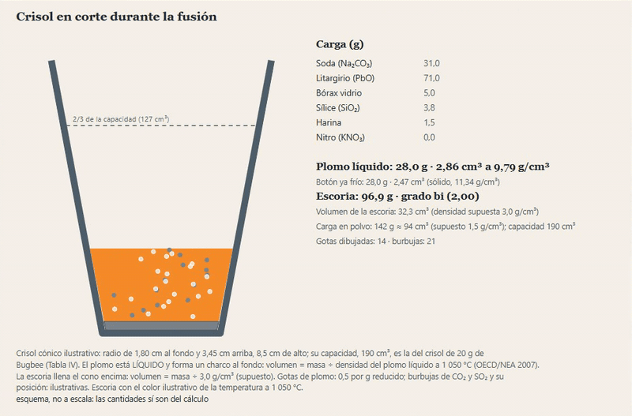

[English version](README.en.md)

# laboratorio-ensayos

Laboratorio de ensayos al fuego. **Fase 1: preparación de muestras** y **fase 2: carga fundente**. Calcula cuánto error de muestreo mete cada etapa de un protocolo de preparación (chancar, dividir, pulverizar, tomar la alícuota de 30 o 50 g) con la ecuación del error fundamental de Gy, cuánto se acumula, y cuántos granos de oro caen en la alícuota cuando el oro es grueso. Implementado desde la literatura y validado contra números publicados.

Sin copelación ni pérdidas de oro y plata, sin termodinámica de escorias y sin ensayo de platinoides. Los códigos de preparación PREP-31 y PREP-31B son públicos de ALS (alsglobal.com); sin afiliación.



**[▶ Probar en el navegador](https://laboratorio-ensayos-bromrnpno3wqjwkdmqcuov.streamlit.app/)** (Streamlit Community Cloud, sin registro). La app tiene un selector Español / English arriba de la barra lateral; con `?lang=en` abre en inglés.

## Qué hace

- **Protocolo:** varianza de Gy por etapa y acumulada (suma de varianzas relativas), con un nomograma de muestreo en el que la ruta del protocolo se recorre etapa por etapa (reducir el tamaño es un tramo horizontal; dividir, uno vertical). Presets PREP-31, PREP-31B y el protocolo de una mina de oro de Minnitt (2017).
- **Oro grueso:** granos esperados en la alícuota, simulación de 1 000 ensayos repetidos (Poisson, semilla fija), recomendación de screen fire assay si se esperan menos de 20 granos (criterio de Clifton).
- **Fusión (fase 2):** dada la mineralogía de la muestra (9 minerales) y la alícuota (1 assay-ton o 30 g), calcula la carga fundente (litargirio, carbonato de sodio, bórax, sílice, harina o nitro) que da un botón de plomo de 25 a 30 g y una escoria del grado de silicato elegido (mono, sesqui o bi); evalúa una carga cambiada (botón chico o grande, escoria ácida o básica, riesgo de mata) y dibuja el crisol cónico en corte, con el plomo líquido al fondo y la escoria encima.
- **Ensayo de cianuración:** recuperación y ley de cabeza por balance desde (tiempo, oro en solución, oro en residuo), términos L, M y N del núcleo sin reaccionar con sus rectas, modelo potencial y un primer orden con meseta, y un vaso de precipitados en corte con agitador y un indicador de recuperación (ver abajo).
- **Validación:** tabla y gráficos de lo calculado frente a lo publicado.
- **Guía:** el error fundamental, los factores y qué dato pide cada uno, y qué errores de muestreo NO se modelan.

## La ecuación

```
σ² = c·f·g·ℓ·dN³·(1/MS − 1/ML) = K·dN^α·(1/MS − 1/ML)      (dN en cm, masas en g)
```

Las dos formas son la misma: K y α **se calibran por mineral** (ensayo de heterogeneidad o árbol de muestreo) y nunca se suponen. Los del ejemplo (DSA: K = 167,4, α = 1,123; SFA: K = 2 539, α = 1,03) son los que Minnitt (2017) calibró para una mena de oro de Witwatersrand y no valen para otro mineral. El tamaño dN de cada etapa sale de su especificación («70 % bajo 2 mm») más una forma Rosin-Rammler con pendiente m **supuesta** (la app muestra cuánto cambia el error con m, porque dN entra al cubo). La corrección por masa del lote (1/MS − 1/ML) se puede apagar para reproducir la Tabla VIII de Minnitt (2017), que la omite.

## Cómo correrlo

```bash
pip install -e ".[dev,app]"
streamlit run app/streamlit_app.py
pytest --cov=muestreo
```

Para la nube basta `requirements.txt` (versiones fijas; `conminucion` fijado a un commit). La granulometría usa `conminucion.sizes` de [simulador-conminucion](https://github.com/Laxionx/simulador-conminucion).

## Validación

Cortes fijados antes de correr ([tests/test_validacion.py](tests/test_validacion.py)). Lo que no cuadra se muestra tal cual, sin `xfail` ni retoques.

| Fuente | Publicado | Calculado | ¿Cuadra? |
|---|---|---|---|
| Minnitt (2017), *J. SAIMM* 117(2), Tabla VIII | 19 varianzas por etapa (DSA y SFA) | σ² = K·dN^α/MS, sin corrección de lote | **18 de 19** al redondeo publicado. No cuadra una fila de SFA (2 055,56 g, dN 0,0001 cm): publica 0,00005 y sale 0,000094; la fila siguiente sí cuadra |
| Chieregati (2017), *Mining Engineering*, Tabla 2 | 3 etapas y total (0,1079; 32,8 %) | IHL = 3,9787·d^1,6689 con corrección de lote | **14 de 14** al redondeo publicado |
| Clifton et al. (1969), USGS PP 625-C, Fig. 4 | ±34/54 % (20), ±20/25 % (75), ±9/10 % (400), −50/+100 % (7) | ecuaciones (11) y (12) del artículo | **7 de 8** a ±2 puntos; el límite inferior de 7 partículas sale −46,6 % (3,4 puntos: la etiqueta de la figura es redonda). El Poisson exacto da −59,8 % |
| Minnitt, Rice y Spangenberg (2007), *J. SAIMM* 107(8) | 29,58 %, ≈16 kg y 0,9 cm | con los datos impresos: 11,69 %, 2,50 kg y 1,69 cm | **no cuadra: hallazgo, no validación** (ver abajo) |

**Minnitt (2007).** El artículo imprime ℓ = 0,000035, pero sus resultados implican un valor 6,4 veces mayor (c·f·g·ℓ = 448 en lugar de 70, ℓ efectivo 0,000224); aquí se usa la fórmula con los datos impresos. Con 448 se reproducen los tres problemas (29,58 %, 16 015 g, 0,91 cm) y el del apéndice (32,49 %), y lo que sí cuadra del apéndice es el tamaño de liberación dℓ = 1,25·(3,5e-5)^(1/1,5) = 0,001337 cm. Es una errata del artículo, no una validación de la fórmula.

La simulación de oro grueso se valida contra Poisson: media y desviación de los 1 000 ensayos dentro de 3σ del valor analítico (error de Monte Carlo), con semilla fija.

## Fase 2: carga fundente

El módulo `muestreo.fusion` (con `fusion_avisos`, `quimica` y los datos de validación en `fusion_datos`) calcula:

- el **poder reductor** de la muestra por estequiometría (g de Pb que reduce 1 g del mineral con litargirio en exceso; el azufre sale como SO2 o como SO3, como en Bugbee) y el de la harina (**dato del laboratorio**: Bugbee da 10 a 12, el USGS 10 a 11; valor inicial 11);
- el **nitro** si la muestra reduce de más (poder oxidante, dato del laboratorio: 4,0 a 4,2 según Bugbee; 5,12 el teórico);
- el balance ácido-base para el **grado de silicato** pedido (oxígeno del ácido / oxígeno de la base: mono 1, sesqui 1,5, bi 2) con sílice y bórax (1 g de bórax vidrio equivale a 0,6 g de sílice);
- el **botón** esperado, la composición y el grado de la escoria y los **avisos**: botón fuera de 25 a 30 g, escoria más ácida que tri-silicato o más básica que mono-silicato, riesgo de mata con sulfuros, poco litargirio (exceso de Lodge) o mucho cobre (Perkins, USGS). Cada umbral lleva su cita; los que no tienen cita publicada se rotulan «umbral supuesto».

Fuentes, ambas de dominio público: Bugbee (1922), *A Textbook of Fire Assaying*, y Haffty, Riley y Goss (1977), *A Manual on Fire Assaying*, USGS Bulletin 1445. No es la receta de ningún laboratorio. Temperatura de fusión para el color del crisol: 1 050 °C (USGS); el crisol es un **cono** (ancho arriba) de 190 cm³ de capacidad, la del crisol de mufla de 20 g de Bugbee (Tabla IV; sus radios y alto, 1,8, 3,45 y 8,5 cm, son **ilustrativos**); en la fusión el plomo está **líquido**, un charco al fondo del cono con volumen = masa ÷ densidad del plomo líquido a 1 050 °C (11 367 − 1,1944·T kg/m³, T en K: 9,787 g/cm³; OECD/NEA 2007, cap. 2, ec. 2.23; la correlación de Assael et al. no se pudo verificar en una copia abierta, y a 600,6 K esta recta da 10,650 frente a los 10,656 que Assael da); la escoria llena el cono encima (su densidad, 3,0 g/cm³, es un **supuesto ilustrativo**, porque Bugbee no la da); el nivel de cada capa sale de integrar el cono, así que el plomo queda siempre debajo de la escoria. El botón ya frío (g y cm³ con 11,34 g/cm³, CRC) se da aparte. Avisos: la carga en polvo (con 1,5 g/cm³, supuesto) o lo fundido que pasen de 2/3 de la capacidad (Bugbee: «nunca más de dos tercios llenos») o de la capacidad entera.

### Validación de la fase 2

Cortes fijados antes de correr ([tests/test_fusion.py](tests/test_fusion.py)); la app calcula SIEMPRE con pesos atómicos actuales; Bugbee calculó a mano con pesos redondeados y a veces truncó. Cada cifra se muestra con cuatro columnas (publicada, pesos actuales, pesos de Bugbee, veredicto): «cuadra», «cuadra con los pesos de Bugbee», «truncamiento de Bugbee» o «no cuadra» (con su diferencia, sin retoques). El juego de pesos de Bugbee está en `muestreo/fusion_pesos.py` y se INFIERE de sus propias cifras, a favor suyo.

| Fuente | Publicado | Calculado | ¿Cuadra? |
|---|---|---|---|
| Bugbee 1922, poderes reductores (carbono, hierro, azufre, pirita), nitro, minio, MnO2 | 34,5; 3,70; 12,9; 19,4; 8,6; 12,9; 12,07; 5,12; 0,30; 2,4 | estequiometría | de 67 cifras: 43 cuadran, 14 cuadran con los pesos de Bugbee, 3 son truncamiento suyo y 7 no cuadran (ver la Validación) |
| Bugbee 1922, Tabla XX (8 minerales, S a SO2 y SO3) | 16 cifras | electrones que entrega cada mineral | 10 cuadran; 4 con los pesos de Bugbee (calcopirita SO3, esfalerita SO2, pirita SO3, pirrotita SO2); 2 no cuadran (arsenopirita y estibina, S a SO3) |
| Bugbee 1922, neutralización de bases y Tablas XXI y XXII | 0,84 y 0,60 g de SiO2; 1,4 y 1,0 g de bórax; 8 + 7 cifras de factores | estequiometría | las de 0,84, 0,60, 1,4, 1,0, PbO y MgCO3 sí; varias de las tablas, con sus pesos o por truncamiento suyo; no cuadran Fe2O3, FeO de la Tabla XXII y el CaCO3 (su 17,4 no concuerda con su propio 0,60 g por g, que da 17,5) |
| Bugbee 1922, ejemplo de 50 % CaCO3 y 50 % SiO2 | 8,7; 17,0; 8,1; 33,8; 14,6; 19,2; 12,8; 6,4; 10,7 | con los factores tabulados de Bugbee | **9 de 9** exactos |
| Bugbee 1922, ejemplos con la calculadora | 30,7 y 43,2 g (1 A.T. de sílice pura); 10,7, 12,8 y 60 g (50 % CaCO3); 23,6, 28,3 y 60 g (CaCO3 puro) | 30,87 y 43,34; 10,70, 12,84 y 60,16; 23,66, 28,39 y 60,16 | dentro de 0,2 g (estequiometría actual) |
| Bugbee 1922, mezcla 3,5 : 0,5 : 6 | 100 g ⇒ ≈ bi-silicato; 125 g ⇒ ≈ sesqui-silicato | grado 2,31 y 1,78 | sí (corte: 2 ± 0,35 y 1,5 ± 0,35) |
| USGS 1445, nitro de un botón de 30 g | 10,7 g | 10,7 g | sí |

Se muestran junto a los teóricos, sin ser corte: los poderes reductores **medidos** de Bugbee (Tabla XX) y las cargas del USGS evaluadas con la calculadora (botón y grado de silicato que darían).

## Ensayo de cianuración

La pestaña «Ensayo de cianuración» lee un ensayo de cianuración (oro en solución y en residuo contra tiempo) y muestra qué modelo cinético describe la disolución y cuál solo ajusta bien en apariencia. El módulo `muestreo.cianuracion` (con `cianuracion_datos`) calcula la recuperación R = (1 − residuo/S0) y la ley de cabeza por balance (con aviso si las filas no son coherentes), los términos L (difusión), M (reacción) y N (mixto) del núcleo sin reaccionar con sus regresiones por tramo, el modelo potencial de los autores y un primer orden con meseta (modelo nuestro). Un vaso de precipitados en corte con agitador muestra un indicador de recuperación que sigue el modelo elegido en un tiempo comprimido (48 h en 12 s, declarado en el dibujo); la velocidad de agitación no se informa en el artículo, así que el giro del agitador es ilustrativo y está rotulado. El ensayo del artículo es una lixiviación agitada en un vaso de 2 L (428 g, 30 % de sólidos, NaCN 2 200 mg/L, pH 10,5); la botella rodante es otra variante del ensayo y aquí no tiene datos.

**Resultado.** Las rectas del núcleo sin reaccionar no pasan por el origen: sus interceptos del primer tramo son 0,335 (difusión), 0,389 (reacción) y 0,385 (mixto), con R² de 0,995 a 0,996 pero solo 3 puntos. Con ellos los modelos ya darían 77 % de oro disuelto en t = 0, y la medición da 79 % a 1 h: no explican la disolución rápida de la primera hora. El modelo potencial ajusta mejor (R² 0,937; error medio 1,6 puntos de recuperación) pero es empírico, y el primer orden con meseta ajusta mal (R∞ = 89,2 %, k = 2,13 1/h, R² 0,48).

### Validación de la cianuración

Datos y cifras de Roostaei, Kordparijaei y Mesroghli (2026), *Discover Applied Sciences*, doi 10.1007/s42452-026-08420-8 (acceso abierto CC BY-NC-ND; solo se usan sus cifras citadas). Cortes fijados antes de correr ([tests/test_cianuracion.py](tests/test_cianuracion.py)):

| Fuente | Qué se compara | Cuadran |
|---|---|---|
| Tabla 4 | Ley de cabeza de cada fila (S0 = residuo/(1 − R), debe caer en el intervalo del redondeo con S0 = 1 070 ppb) y recuperación al redondeo | 14 de 14 |
| Tabla 6 | L y M a 3 decimales; N con la B inferida | 22 de 22 |
| Tabla 7 | R², intercepto y pendiente de las 6 regresiones, con los mismos puntos (sin el de 2 h) | 15 de 18 |
| Ec. 3 | 228,046; 0,332; R² 0,937 (ln St contra ln t, 7 puntos) | 3 de 3 |

**Lo que no cuadra.** La fila M1 de la Tabla 7 no sale de los datos: con los términos M de la Tabla 6 da R² 0,9957, intercepto 0,389 y pendiente 0,018, y el artículo imprime 0,994, 0,388 y 0,019; su F impreso (171,04) implica R² 0,9942, coherente con su propio R² pero no con los datos, y las otras cinco filas sí cuadran. Parece una errata y no se maquilló. Con 30 % de sólidos se esperaría una razón de 2,33 L/kg y el factor sólido por solución que sale de la Tabla 4 es 1,935: apunta a una inconsistencia del balance del artículo.

**Lo inferido** (el artículo no lo publica y se declara): la constante B del término mixto, 0,7033 hasta 7 h y 0,75 de 7 a 48 h (rangos compatibles con el redondeo: 0,7028 a 0,7039 y 0,7500 a 0,7505); la ley de cabeza, 1 070 ppb; y el factor sólido por solución, 1,935. Son nuestros: el primer orden con meseta, la regla que deja fuera el punto de 2 h (su recuperación supera la de 3 h) y la tolerancia de 5 % de la cabeza.

## Límites

- Fase 1: solo el error fundamental de muestreo de Gy: no hay errores de delimitación y extracción, de preparación (contaminación, pérdidas), de ponderación, de segregación y agrupamiento, ni el error analítico.
- K y α son del ejemplo publicado; cada laboratorio debe calibrar los suyos.
- Los granos de oro se suponen de un solo tamaño y forma (esfera o cubo), libres y al azar.
- Los equipos de preparación no se simulan: el tamaño de cada etapa sale de la especificación del protocolo.

## Licencia

MIT.
